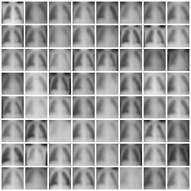
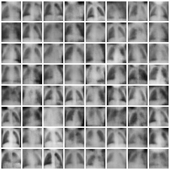
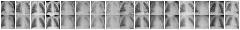
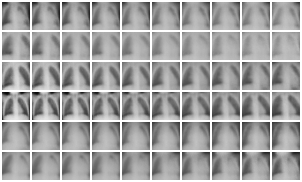
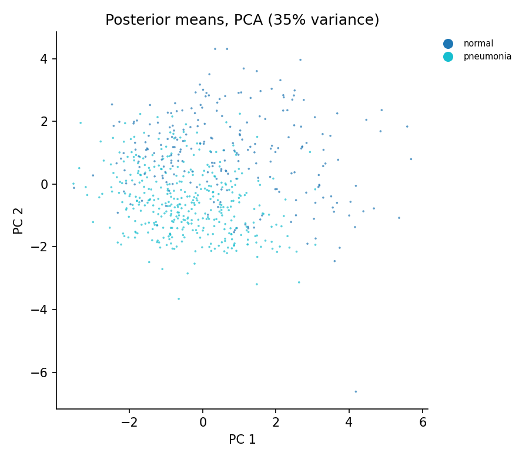
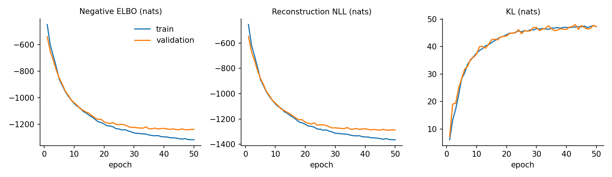

# conv-vae-pytorch


A small, self-contained **variational autoencoder (VAE)** in PyTorch, trained on binarised MNIST and on [PneumoniaMNIST](https://medmnist.com/) paediatric chest X-rays, and runnable on any 2D MedMNIST dataset (e.g. blood cell microscopy, abdominal CT). The goal is a clean, tested reference implementation: a convolutional encoder and decoder, the reparameterisation trick, a closed-form KL term, and evaluation that goes beyond the training loss (an importance-weighted likelihood estimate and a check for posterior collapse).

<p align="center">
  
  &nbsp;&nbsp;
  
</p>
<p align="center"><em>Left: new digits generated by sampling z ~ N(0, I) and decoding (16-D latent). Right: decoded grid over a 2-D latent space.</em></p>

## Model

| Component | Architecture |
|---|---|
| Encoder q(z\|x) | Conv 4x4/2 (32) → Conv 4x4/2 (64) → Dense 256 → two heads giving μ and log σ² |
| Latent | Diagonal Gaussian, 16 dimensions by default (2 for visualisation) |
| Decoder p(x\|z) | Dense 256 → Dense 64·7·7 → ConvT 4x4/2 (32) → ConvT 4x4/2 (C); Bernoulli likelihood for binary images, calibrated Gaussian for grey-level and colour images |
| Parameters | 1,688,289 (16-D latent, 1 channel) |

Training maximises the evidence lower bound

$$\log p(x) \;\ge\; \mathbb{E}_{q(z|x)}[\log p(x|z)] \;-\; \mathrm{KL}\big(q(z|x)\,\|\,\mathcal{N}(0, I)\big)$$

with the expectation estimated by one reparameterised sample, z = μ + σ ⊙ ε with ε ~ N(0, I), and the KL computed in closed form. A β weight on the KL term (β-VAE) and linear KL warm-up are available as options.

## Results on MNIST

Binarised MNIST: 55,000 training images (resampled each epoch), 5,000 held out for validation and model selection, and the standard 10,000 test images (binarised once with a fixed seed so results are reproducible). Adam, learning rate 1e-3, batch size 128, seed 0, CPU only. All values are nats per image on the **test set**, lower is better.

| Latent dim | Epochs | −ELBO | Reconstruction | KL | −log p(x), IW k=100 | Active units |
|---|---|---|---|---|---|---|
| 16 | 50 | 92.00 | 68.74 | 23.27 | **87.67** | 15 / 16 |
| 2 | 30 | 142.54 | 135.83 | 6.71 | **139.36** | 2 / 2 |

* **−log p(x), IW k=100** is the importance-weighted bound of Burda et al. (2016) using 100 samples from q(z\|x). It is tighter than the ELBO and is the better estimate of how well the model fits the data; the gap between the two columns (about 4.3 nats for the 16-D model) measures how far the Gaussian posterior is from the true one.
* **Active units** counts latent dimensions whose posterior mean actually varies across images (variance > 0.01). One of the 16 dimensions collapsed to the prior, so the model chose to use 15.

### Reconstructions (top: test images, bottom: reconstruction from the posterior mean)


### Latent interpolation between pairs of test digits


### Latent space
<p align="center">
  
  
</p>
<p align="center"><em>Posterior means of the test set coloured by digit class (labels are never used in training). Left: 2-D latent. Right: 16-D latent projected with PCA.</em></p>

### Training curves (16-D model)


## Results on PneumoniaMNIST (chest X-rays)

PneumoniaMNIST (Yang et al., 2023) contains 28x28 grey-level paediatric chest X-rays labelled normal or pneumonia, with official splits of 4,708 training, 524 validation and 624 test images. The model, latent size (16) and training settings are the same as for MNIST, and the labels are never used in training.

The first run used the same binary cross-entropy loss as MNIST, and the model largely ignored its latent space. Switching to the calibrated Gaussian decoder (see [Design notes](#design-notes)) fixed this:

| Decoder | KL, information carried by the latent (nats) | Active units | Checkpoint epoch |
|---|---|---|---|
| Binary cross-entropy | 4.66 | 9 / 16 | 50 |
| Calibrated Gaussian | **46.74** | **16 / 16** | 48 |

Test-set values. With cross-entropy, 7 of the 16 latent dimensions collapsed to the prior and each X-ray was encoded with under 5 nats of information, so outputs were close to an average chest. The Gaussian decoder carries ten times more information and uses every dimension. (The ELBO itself is not comparable between the two decoders; for the Gaussian model the test −ELBO is −1189.87 nats and the importance-weighted estimate −1212.01 nats, as continuous densities. Full metrics are in [`results/`](results).)

### Samples from the prior
<p align="center">
  
  &nbsp;&nbsp;
  
</p>
<p align="center"><em>Left: cross-entropy decoder. Right: calibrated Gaussian decoder, with visible lung fields, ribs and variation in patient position and exposure.</em></p>

### Reconstructions (top: test X-rays, bottom: reconstruction), Gaussian decoder


### Latent interpolation between pairs of test X-rays


### Latent space and training curves
<p align="center">
  
</p>
<p align="center"><em>Posterior means of the 624 test X-rays (PCA of the 16-D latent), coloured by diagnosis. Normal and pneumonia images partially separate even though the model never saw a label.</em></p>



Validation loss levels off after about 30 epochs while training loss keeps improving (a gap of 78 nats by epoch 50), which is mild overfitting on this small training set; the checkpoint with the best validation ELBO (epoch 48) is the one evaluated.

## Quick start

```bash
git clone https://github.com/g-Poulami/conv-vae-pytorch.git
cd conv-vae-pytorch
pip install -r requirements.txt

# train, evaluate on the test set, and write figures to runs/mnist_z16/
python -m vae.train --dataset mnist --latent-dim 16 --epochs 50

# 2-D latent model for the manifold and latent-space plots
python -m vae.train --dataset mnist --latent-dim 2 --epochs 30

# medical images (downloaded automatically by the medmnist package; Gaussian decoder by default)
python -m vae.train --dataset pneumoniamnist --latent-dim 16 --epochs 50
python -m vae.train --dataset bloodmnist     --latent-dim 16 --epochs 50

# re-run evaluation or figures on an existing run
python -m vae.evaluate  --run-dir runs/mnist_z16 --iw-samples 100
python -m vae.visualise --run-dir runs/mnist_z16

# unit tests
pytest -q
```

One epoch on MNIST takes about 25 seconds on a 2-core CPU; a GPU (CUDA) or Apple Silicon (MPS) is used automatically if available. Run `python -m vae.train --help` for all options.

Each run directory contains `config.json`, `history.csv` (per-epoch train and validation losses), `best.pt` (lowest validation −ELBO), `last.pt`, `test_metrics.json` and `figures/`.

### Datasets

| `--dataset` | Source | Channels | Notes |
|---|---|---|---|
| `mnist`, `fashionmnist` | torchvision | 1 | binarised; 5,000 training images held out for validation |
| any 2D MedMNIST flag, e.g. `pneumoniamnist`, `bloodmnist`, `organamnist`, `dermamnist` | [MedMNIST v2](https://medmnist.com/) | 1 or 3 | intensities in [0, 1]; official train / val / test splits |

## Repository layout

```
vae/
  model.py       ConvVAE: encoder, reparameterisation, decoder, sampling
  losses.py      ELBO terms, importance-weighted NLL, active-unit count
  data.py        MNIST / Fashion-MNIST / MedMNIST loaders and binarisation
  train.py       training loop, checkpointing, final evaluation and figures
  evaluate.py    test-set metrics for a saved checkpoint
  visualise.py   reconstructions, samples, interpolations, latent plots, curves
tests/
  test_vae.py    shapes, KL and Gaussian likelihood against torch.distributions, IW bound
                 tightening, sigma calibration, overfitting a batch
results/         metrics and training history for the runs reported above
assets/          figures used in this README
```

## Design notes

* **The decoder likelihood matches the data.** For binarised MNIST the decoder is Bernoulli and the reconstruction term is a binary cross-entropy, an exact log-likelihood for binary pixels, so the reported nats are comparable with the VAE literature. Binary cross-entropy is a poor choice for grey-level images: it behaves like a Gaussian decoder with a very large, fixed noise level, so the model can explain away image detail as noise and leave most of its latent space unused. For grey-level and colour data (all MedMNIST sets) the default is therefore a Gaussian decoder whose noise scale σ is calibrated to the reconstruction error (the "optimal σ" decoder of Rybkin et al., 2021). Override with `--likelihood bernoulli` or `--likelihood gaussian`. Gaussian results are continuous densities, so their nats are not comparable with the Bernoulli numbers.
* **Model selection on a validation split**, never the test set.
* **Tests check the maths, not just the shapes**: the closed-form KL and the Gaussian likelihood are compared with `torch.distributions`, and the importance-weighted bound is checked to be tighter than the single-sample ELBO.

## References

* Kingma, D. P. & Welling, M. (2014). Auto-Encoding Variational Bayes. *ICLR*. [arXiv:1312.6114](https://arxiv.org/abs/1312.6114)
* Rezende, D. J., Mohamed, S. & Wierstra, D. (2014). Stochastic Backpropagation and Approximate Inference in Deep Generative Models. *ICML*. [arXiv:1401.4082](https://arxiv.org/abs/1401.4082)
* Burda, Y., Grosse, R. & Salakhutdinov, R. (2016). Importance Weighted Autoencoders. *ICLR*. [arXiv:1509.00519](https://arxiv.org/abs/1509.00519)
* Rybkin, O., Daniilidis, K. & Levine, S. (2021). Simple and Effective VAE Training with Calibrated Decoders. *ICML*. [arXiv:2006.13202](https://arxiv.org/abs/2006.13202)
* Higgins, I. et al. (2017). β-VAE: Learning Basic Visual Concepts with a Constrained Variational Framework. *ICLR*.
* Yang, J. et al. (2023). MedMNIST v2: A large-scale lightweight benchmark for 2D and 3D biomedical image classification. *Scientific Data* 10, 41.

## Licence

MIT, see [LICENSE](LICENSE).
