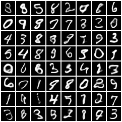
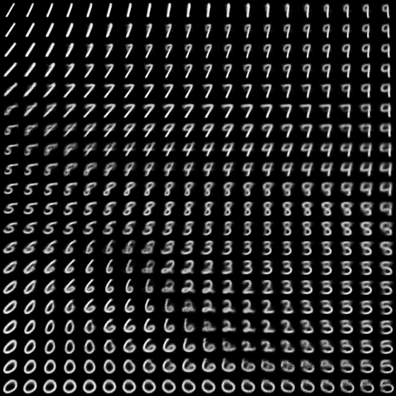
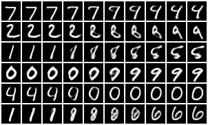
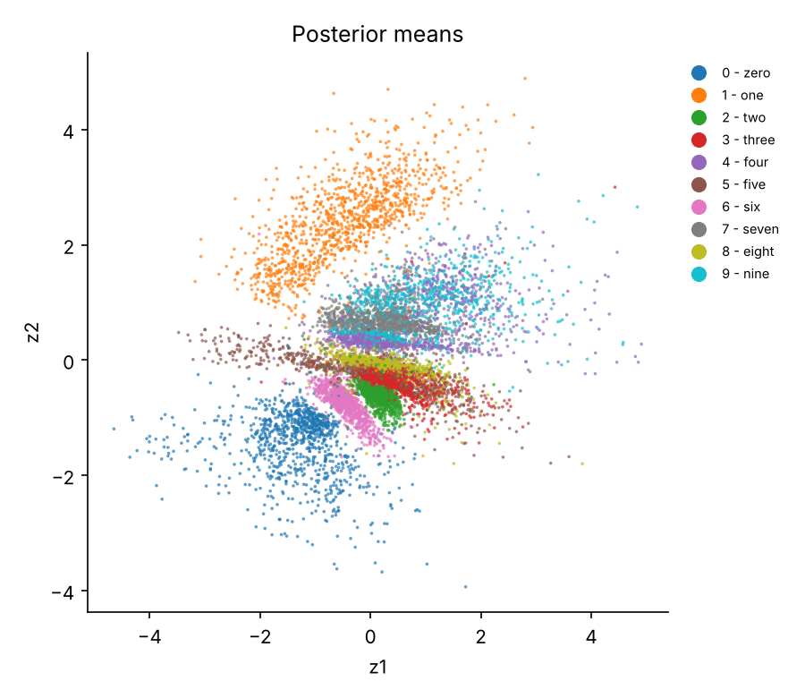
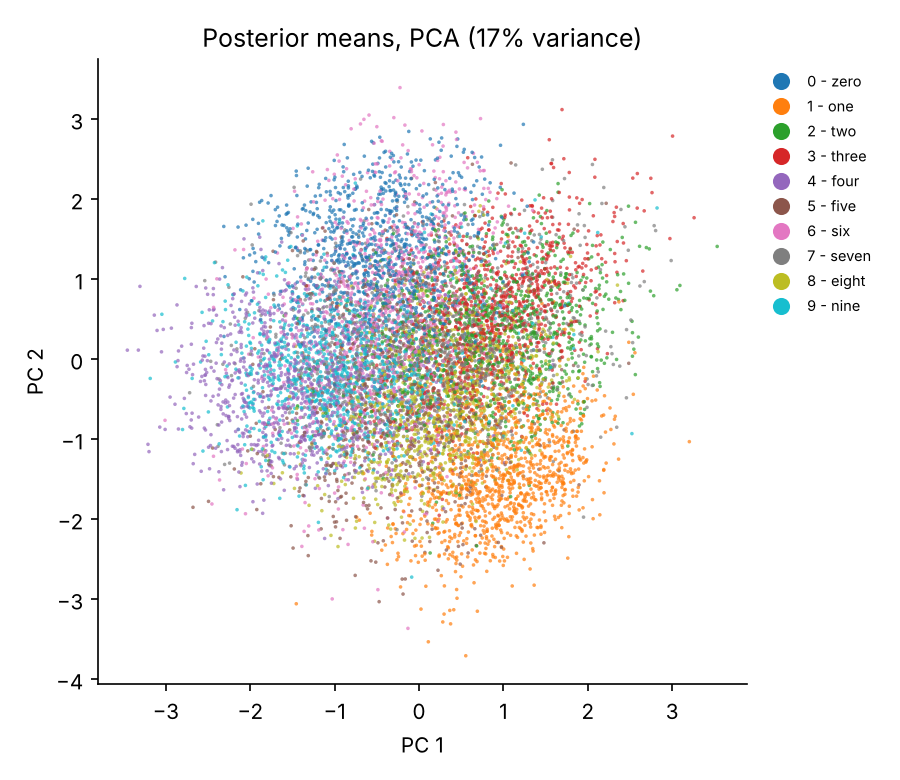
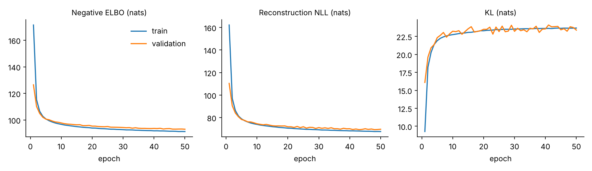

# conv-vae-pytorch


A small, self-contained **variational autoencoder (VAE)** in PyTorch, trained on binarised MNIST and runnable on any 2D [MedMNIST](https://medmnist.com/) dataset (e.g. chest X-rays, blood cell microscopy, abdominal CT). The goal is a clean, tested reference implementation: a convolutional encoder and decoder, the reparameterisation trick, a closed-form KL term, and evaluation that goes beyond the training loss (an importance-weighted likelihood estimate and a check for posterior collapse).

<p align="center">
  
  &nbsp;&nbsp;
  
</p>
<p align="center"><em>Left: new digits generated by sampling z ~ N(0, I) and decoding (16-D latent). Right: decoded grid over a 2-D latent space.</em></p>

## Model

| Component | Architecture |
|---|---|
| Encoder q(z\|x) | Conv 4x4/2 (32) → Conv 4x4/2 (64) → Dense 256 → two heads giving μ and log σ² |
| Latent | Diagonal Gaussian, 16 dimensions by default (2 for visualisation) |
| Decoder p(x\|z) | Dense 256 → Dense 64·7·7 → ConvT 4x4/2 (32) → ConvT 4x4/2 (C), per-pixel Bernoulli logits |
| Parameters | 1,688,289 (16-D latent, 1 channel) |

Training maximises the evidence lower bound

$$\log p(x) \;\ge\; \mathbb{E}_{q(z|x)}[\log p(x|z)] \;-\; \mathrm{KL}\big(q(z|x)\,\|\,\mathcal{N}(0, I)\big)$$

with the expectation estimated by one reparameterised sample, z = μ + σ ⊙ ε with ε ~ N(0, I), and the KL computed in closed form. A β weight on the KL term (β-VAE) and linear KL warm-up are available as options.

## Results on MNIST

Binarised MNIST: 55,000 training images (resampled each epoch), 5,000 held out for validation and model selection, and the standard 10,000 test images (binarised once with a fixed seed so results are reproducible). Adam, learning rate 1e-3, batch size 128, seed 0, CPU only. All values are nats per image on the **test set**, lower is better.

| Latent dim | Epochs | −ELBO | Reconstruction | KL | −log p(x), IW k=100 | Active units |
|---|---|---|---|---|---|---|
| 16 | 50 | 92.00 | 68.74 | 23.27 | **87.67** | 15 / 16 |
| 2 | 30 | 142.54 | 135.83 | 6.71 | **139.36** | 2 / 2 |

* **−log p(x), IW k=100** is the importance-weighted bound of Burda et al. (2016) using 100 samples from q(z\|x). It is tighter than the ELBO and is the better estimate of how well the model fits the data; the gap between the two columns (about 4.3 nats for the 16-D model) measures how far the Gaussian posterior is from the true one.
* **Active units** counts latent dimensions whose posterior mean actually varies across images (variance > 0.01). One of the 16 dimensions collapsed to the prior, so the model chose to use 15.

### Reconstructions (top: test images, bottom: reconstruction from the posterior mean)


### Latent interpolation between pairs of test digits


### Latent space
<p align="center">
  
  
</p>
<p align="center"><em>Posterior means of the test set coloured by digit class (labels are never used in training). Left: 2-D latent. Right: 16-D latent projected with PCA.</em></p>

### Training curves (16-D model)


## Quick start

```bash
git clone https://github.com/GITHUB_USERNAME/conv-vae-pytorch.git
cd conv-vae-pytorch
pip install -r requirements.txt

# train, evaluate on the test set, and write figures to runs/mnist_z16/
python -m vae.train --dataset mnist --latent-dim 16 --epochs 50

# 2-D latent model for the manifold and latent-space plots
python -m vae.train --dataset mnist --latent-dim 2 --epochs 30

# medical images (downloaded automatically by the medmnist package)
python -m vae.train --dataset pneumoniamnist --latent-dim 16 --epochs 50
python -m vae.train --dataset bloodmnist     --latent-dim 16 --epochs 50

# re-run evaluation or figures on an existing run
python -m vae.evaluate  --run-dir runs/mnist_z16 --iw-samples 100
python -m vae.visualise --run-dir runs/mnist_z16

# unit tests
pytest -q
```

One epoch on MNIST takes about 25 seconds on a 2-core CPU; a GPU (CUDA) or Apple Silicon (MPS) is used automatically if available. Run `python -m vae.train --help` for all options.

Each run directory contains `config.json`, `history.csv` (per-epoch train and validation losses), `best.pt` (lowest validation −ELBO), `last.pt`, `test_metrics.json` and `figures/`.

### Datasets

| `--dataset` | Source | Channels | Notes |
|---|---|---|---|
| `mnist`, `fashionmnist` | torchvision | 1 | binarised; 5,000 training images held out for validation |
| any 2D MedMNIST flag, e.g. `pneumoniamnist`, `bloodmnist`, `organamnist`, `dermamnist` | [MedMNIST v2](https://medmnist.com/) | 1 or 3 | intensities in [0, 1]; official train / val / test splits |

## Repository layout

```
vae/
  model.py       ConvVAE: encoder, reparameterisation, decoder, sampling
  losses.py      ELBO terms, importance-weighted NLL, active-unit count
  data.py        MNIST / Fashion-MNIST / MedMNIST loaders and binarisation
  train.py       training loop, checkpointing, final evaluation and figures
  evaluate.py    test-set metrics for a saved checkpoint
  visualise.py   reconstructions, samples, interpolations, latent plots, curves
tests/
  test_vae.py    shapes, KL against torch.distributions, IW bound tightening, overfitting a batch
results/         metrics and training history for the runs reported above
assets/          figures used in this README
```

## Design notes

* **Bernoulli decoder on binarised data.** The decoder outputs logits and the reconstruction term is a binary cross-entropy, which is an exact log-likelihood only for binary pixels. Binarising MNIST makes the reported nats meaningful and comparable with the VAE literature. For grey-level MedMNIST images the same loss is used as a standard reconstruction objective, so those numbers should be read as training losses rather than likelihoods.
* **Model selection on a validation split**, never the test set.
* **Tests check the maths, not just the shapes**: the closed-form KL is compared with `torch.distributions`, and the importance-weighted bound is checked to be tighter than the single-sample ELBO.

## References

* Kingma, D. P. & Welling, M. (2014). Auto-Encoding Variational Bayes. *ICLR*. [arXiv:1312.6114](https://arxiv.org/abs/1312.6114)
* Rezende, D. J., Mohamed, S. & Wierstra, D. (2014). Stochastic Backpropagation and Approximate Inference in Deep Generative Models. *ICML*. [arXiv:1401.4082](https://arxiv.org/abs/1401.4082)
* Burda, Y., Grosse, R. & Salakhutdinov, R. (2016). Importance Weighted Autoencoders. *ICLR*. [arXiv:1509.00519](https://arxiv.org/abs/1509.00519)
* Higgins, I. et al. (2017). β-VAE: Learning Basic Visual Concepts with a Constrained Variational Framework. *ICLR*.
* Yang, J. et al. (2023). MedMNIST v2: A large-scale lightweight benchmark for 2D and 3D biomedical image classification. *Scientific Data* 10, 41.

## Licence

MIT, see [LICENSE](LICENSE).
